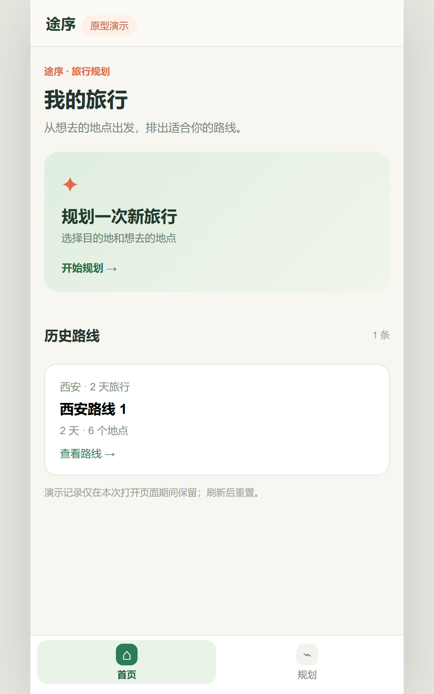
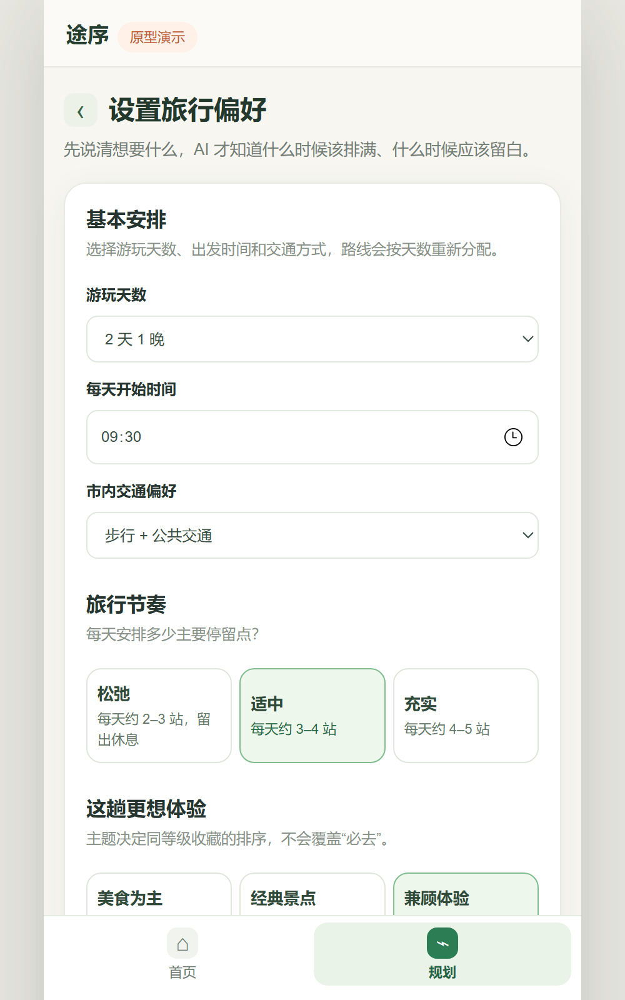
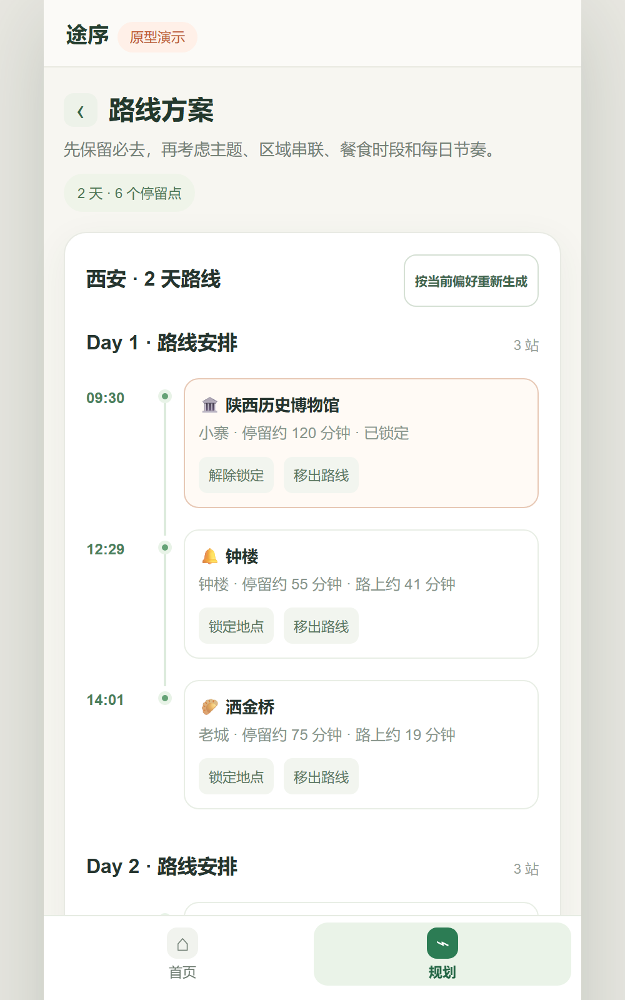
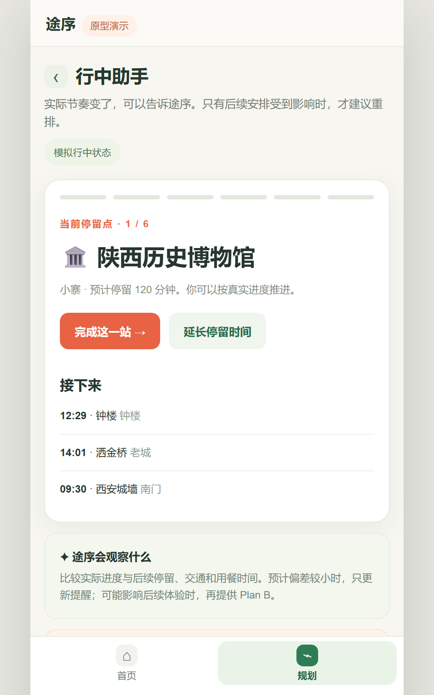
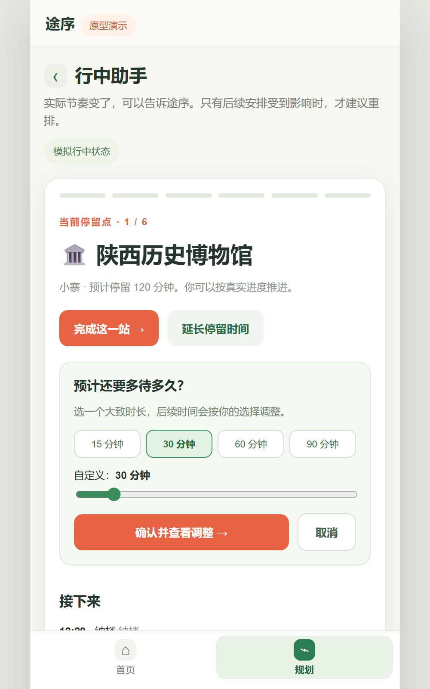
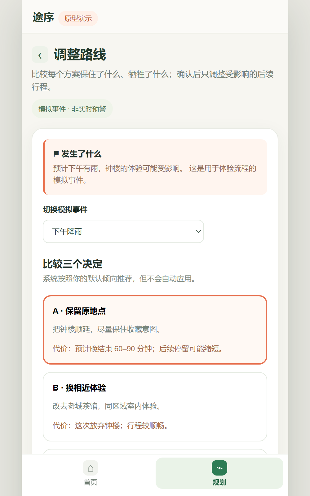

# 途序 Tripwise｜旅行规划与行中调整原型

**[直接体验交互原型](https://yyyyskbfxx.github.io/Tripwise/)** · [作品集案例说明](https://yyyyskbfxx.github.io/AI-Demo/travel-project.html)

途序面向旅行前收藏了很多地点、却难以排出合适路线的自由行用户。它把“选择真正想去的地方”和“旅途中发生变化后如何调整”放进同一条流程：先表达地点优先级与旅行偏好，再生成可调整的日程；遇到变化时比较 Plan B 的影响，由用户决定是否应用。

## 产品目标与设计判断

1. **先表达优先级，再排路线。** “必去、想去、顺路”帮助用户区分真正要保留的地点。
2. **让偏好参与排程。** 天数、开始时间、节奏、主题和交通方式影响每日路线；用户可锁定或移出地点。
3. **变化后展示取舍。** Plan B 比较保留顺延、相近替换与减少一站的影响，用户确认后才应用。

## 页面设计与功能

底部保留「首页 / 规划」两个入口。规划依次完成地点选择、偏好设置和路线生成；从路线进入行中助手与 Plan B。以下为同尺寸手机视口截图，点击可查看完整页面。

### ① 开始规划

&nbsp;&nbsp;

- **首页：**发起新规划，或打开本次会话保存的历史路线。
- **选择地点：**选择城市与收藏地点，标记「必去 / 想去 / 顺路」；地点位置与优先级参与排程。

### ② 生成路线

&nbsp;&nbsp;

- **规划偏好：**设置游玩天数、开始时间、交通方式、节奏、主题和变化时的默认倾向。
- **路线方案：**按天查看预计到达时间、停留和路程；可锁定、移出地点或重新生成。

### ③ 旅行中调整

&nbsp;&nbsp;

- **行中助手：**记录当前站是否完成，查看后续安排。
- **延长停留：**快捷选择 15、30、60、90 分钟，或在 10–180 分钟内自定义时长。

### ④ 比较 Plan B

模拟天气、人流或交通变化，比较保留顺延、相近替换和减少一站；用户确认后才应用。

## 核心流程与实现

首页进入规划 → 选择城市和地点并标注优先级 → 设置偏好 → 查看按天排布的路线 → 进入行中助手 → 触发模拟变化 → 比较并确认 Plan B。原型使用原生 HTML、CSS、JavaScript；`travel.js` 包含演示地点、偏好权重、路线生成和候选调整逻辑。打开 `index.html` 即可本地体验。

地点位置、路程、时间、天气、人流和交通变化为模拟或估算数据；尚未接入实时地图、交通或天气服务，路线也未经过真实出行验证。历史路线仅在当前页面会话保留，刷新后重置。
